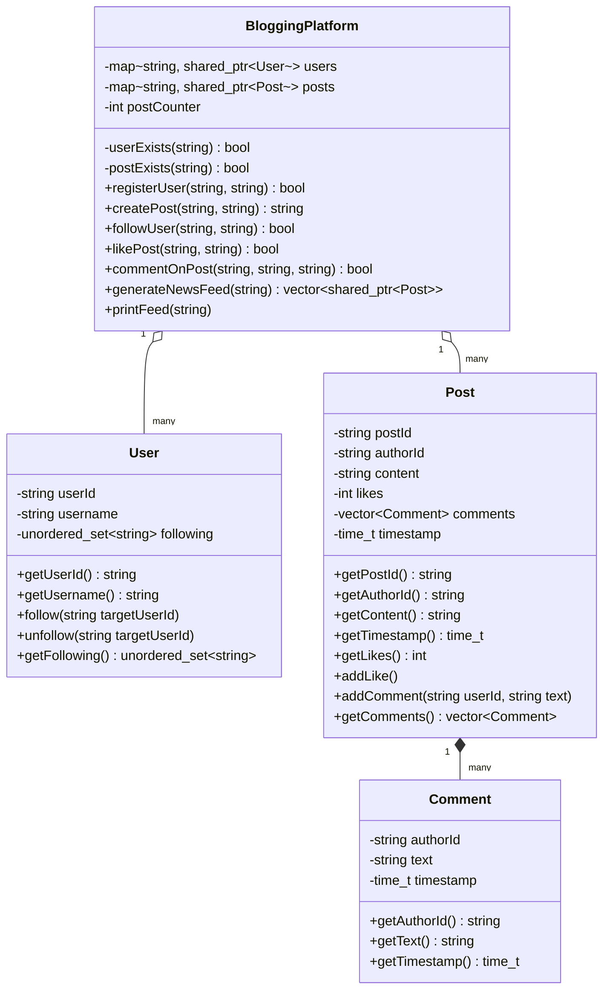
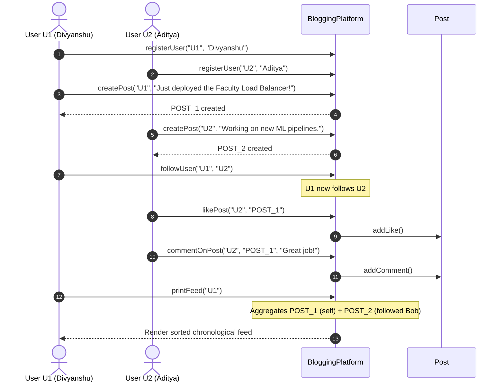

# Blogging Platform (Social Network / News Feed) - Low Level Design (LLD)

## 📌 Problem Overview
Design the core backend domain and orchestration service for a **Blogging Platform / Social Media Service** (analogous to Twitter, Threads, or Medium). The system enables user registration, content creation (posts), social relationships (following/unfollowing), interactions (likes and comments), and dynamic chronological news feed generation.

---

## 🎯 Key Requirements

### 1. Functional Requirements
- **User Management**: Register users with unique IDs and usernames.
- **Content Creation**: Authenticated users can publish blog posts with unique IDs, author attribution, and timestamps.
- **Social Graph (Follow / Unfollow)**: Users can follow or unfollow other users. O(1) membership check using hash sets.
- **Social Interactions**:
  - **Likes**: Users can like any published post.
  - **Comments**: Users can leave comments with timestamps on posts.
- **News Feed Generation**:
  - Generate a user's customized feed containing:
    1. Posts authored by people the user follows.
    2. The user's own published posts.
  - Order posts in reverse-chronological order (newest first).

### 2. Non-Functional Requirements & Design Principles
- **Clean Multi-Tier Architecture**: Clear separation among domain entities (`models/`), business logic service (`services/`), and simulation driver (`main.cpp`).
- **Encapsulation & Information Hiding**: Direct mutations to internal sets or vectors are guarded behind domain methods.
- **Time Complexity Optimization**:
  - Follow lookup: $O(1)$ via `std::unordered_set`.
  - User and post lookup: $O(\log U)$ and $O(\log P)$ via `std::map` (or $O(1)$ via `std::unordered_map`).

---

## 🏗️ Architecture & Tier Breakdown

```
Blogging_Platform/
├── models/
│   ├── Comment.h / .cpp         # Value object / entity representing post comments
│   ├── User.h / .cpp            # User entity managing profile & following set
│   └── Post.h / .cpp            # Post entity with content, likes, comments & timestamp
├── services/
│   └── BloggingPlatform.h / .cpp # Central orchestrator & news feed aggregator
├── main.cpp                     # Simulation driver with end-to-end test cases
├── Makefile                     # Build automation with make
├── CMakeLists.txt               # Cross-platform CMake configuration
└── README.md                    # LLD documentation & architecture diagrams
```

---

## ⚖️ System Design Insight: News Feed Architecture (Pull vs. Push)

| Architectural Model | Mechanism in Feed Generation | Pros | Cons |
| :--- | :--- | :--- | :--- |
| **Pull Model (Fan-out on Read)** *(Implemented Here)* | On feed query, fetch all posts authored by followees and sort them on-the-fly. | - Writes are $O(1)$ and immediate.<br>- No storage overhead for timeline caches.<br>- Handles users with millions of followers easily. | - Feed retrieval is slower ($O(N \log N)$ sort).<br>- Traversal scales with number of followees. |
| **Push Model (Fan-out on Write)** | When a user publishes a post, append the post ID directly into every follower's pre-computed inbox. | - Instant feed reads ($O(1)$ retrieval). | - Hot-key problem: Celebrities with 50M+ followers cause heavy write spikes. |
| **Hybrid Approach** | Push for regular users; Pull on-demand for celebrity users with high follower counts. | - Best of both worlds for real-world platforms. | - Increased algorithmic complexity. |

---

## 📊 Class Diagram (Mermaid)



---

## 🔁 User Interaction Sequence Diagram (Mermaid)



---

## ⚙️ How to Build and Run

### Option 1: Direct Compilation via `g++` (C++14/17)
```bash
g++ -std=c++14 -Wall -Wextra -I. \
    main.cpp \
    models/Comment.cpp \
    models/User.cpp \
    models/Post.cpp \
    services/BloggingPlatform.cpp \
    -o blogging_platform

# Run executable:
# On Linux/macOS:
./blogging_platform
# On Windows:
./blogging_platform.exe
```

### Option 2: Using Makefile
```bash
make
make run
```

### Option 3: Using CMake
```bash
mkdir build && cd build
cmake ..
cmake --build .
./blogging_platform
```

---

## 🖥️ Sample Output
```text
--- Starting Blogging Platform Workflow Simulation ---

[System] User Divyanshu created post: POST_1
[System] User Aditya created post: POST_2
[System] User Harshit created post: POST_3
[System] Divyanshu is now following Aditya
[System] Divyanshu is now following Harshit

--- News Feed for Divyanshu ---
[POST_1] Divyanshu says: 'Just deployed the Faculty Load Balancer!' | Likes: 2 | Comments: 1
[POST_2] Aditya says: 'Working on some new ML pipelines.' | Likes: 0 | Comments: 0
[POST_3] Harshit says: 'Organizing the IEEE C++ contest this weekend.' | Likes: 0 | Comments: 0
---------------------------------

--- News Feed for Aditya ---
[POST_2] Aditya says: 'Working on some new ML pipelines.' | Likes: 0 | Comments: 0
---------------------------------
```
