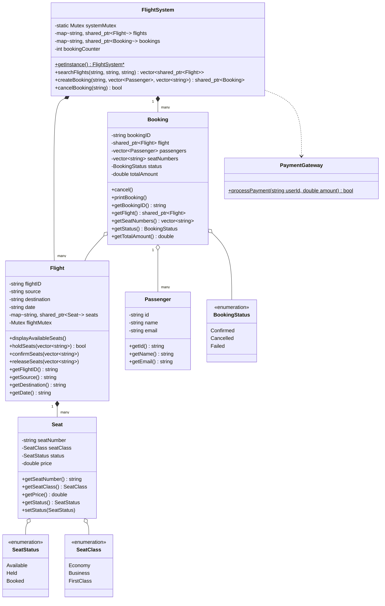
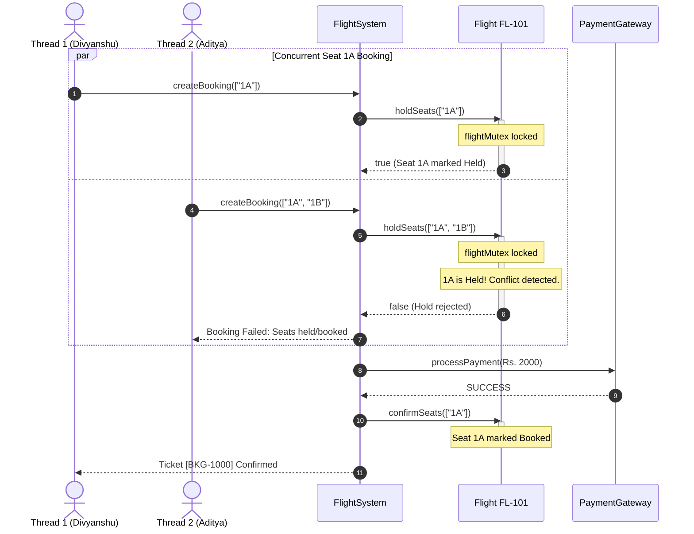

# Flight Booking System - Low Level Design (LLD)

## 📌 Problem Overview
Design a high-concurrency Flight Reservation System capable of searching flights, selecting seats across different travel classes, handling simultaneous booking requests without race conditions or double-booking, processing payments, and supporting cancellations with automatic seat release.

---

## 🎯 Key Requirements

### 1. Functional Requirements
- **Search Flights**: Query flights by source, destination, and travel date.
- **Seat Inventory**: Manage seats categorized into `Economy`, `Business`, and `FirstClass`.
- **Seat State Lifecycle**: Seats transition between `Available` ➔ `Held` ➔ `Booked`.
- **Atomic Multi-Seat Booking**: Users can book multiple seats atomically; partial allocations are prohibited.
- **Payment Processing**: Integrate with payment gateway simulation; support rollback on payment failure.
- **Ticket Generation**: Generate confirmed booking records with flight and passenger details.
- **Cancellation**: Cancel bookings and instantly return booked seats to the available pool.

### 2. Non-Functional Requirements & Concurrency
- **Zero Double-Booking (High Concurrency)**: Prevent race conditions when two or more users attempt to book identical seats simultaneously.
- **Granular Locking Strategy**: Each `Flight` has its own granular mutex to guard seat operations, ensuring high throughput without blocking bookings across different flights.
- **Two-Phase Booking Protocol**:
  1. **Phase 1 (Hold)**: Acquire flight lock, atomically check that *all* requested seats are available, and transition them to `Held`.
  2. **Payment Processing**: Released lock while processing payment gateway call (avoiding holding locks during external I/O).
  3. **Phase 2 (Commit / Rollback)**:
     - On Payment Success: Acquire flight lock and transition seats to `Booked`.
     - On Payment Failure: Acquire flight lock and rollback seats back to `Available`.

---

## 🏗️ Architecture & Tier Breakdown

```
Flight_Booking/
├── enums/
│   └── Enums.h                  # SeatStatus, BookingStatus, SeatClass
├── concurrency/
│   └── Concurrency.h            # Cross-platform Mutex, LockGuard & Thread abstractions
├── models/
│   ├── Passenger.h / .cpp       # Passenger details (id, name, email)
│   ├── Seat.h / .cpp            # Seat number, class, status, price
│   ├── Flight.h / .cpp          # Flight schedule, seats inventory & thread-safe 2PC
│   └── Booking.h / .cpp         # Confirmed/Cancelled booking entity
├── services/
│   ├── PaymentGateway.h / .cpp  # Mock payment gateway with success/failure simulation
│   └── FlightSystem.h / .cpp    # Core Singleton orchestrator for catalog and bookings
├── main.cpp                     # Concurrency simulation driver
├── Makefile                     # Build automation with make
├── CMakeLists.txt               # Cross-platform CMake configuration
└── README.md                    # LLD documentation & diagrams
```

---

## 🧩 Concurrency & Locking Architecture

```
User Request (Thread 1) ──┐
                          ├──► [FlightSystem::createBooking]
User Request (Thread 2) ──┘           │
                                      ▼
                        [Step 1: flight->holdSeats()]
                        (Locks flightMutex: checks all seats)
                                      │
                     ┌────────────────┴────────────────┐
                     ▼                                 ▼
           [All Seats Available]               [Any Seat Taken]
           Marks seats 'Held'                  Return false (Abort)
                     │
                     ▼
             [Payment Gateway]
      (Processes without holding locks)
                     │
         ┌───────────┴───────────┐
         ▼                       ▼
    [SUCCESS]                 [FAILURE]
 [confirmSeats()]          [releaseSeats()]
  Marks 'Booked'          Rolls back to 'Available'
```

---

## 📊 Class Diagram (Mermaid)



---

## 🔁 Concurrency Sequence Diagram (Mermaid)



---

## ⚙️ How to Build and Run

### Option 1: Direct Compilation via `g++` (C++14/17)
```bash
g++ -std=c++14 -Wall -Wextra -I. \
    main.cpp \
    models/Passenger.cpp \
    models/Seat.cpp \
    models/Flight.cpp \
    models/Booking.cpp \
    services/PaymentGateway.cpp \
    services/FlightSystem.cpp \
    -o flight_booking

# Run executable:
# On Linux/macOS:
./flight_booking
# On Windows:
./flight_booking.exe
```

### Option 2: Using Makefile
```bash
make
make run
```

### Option 3: Using CMake
```bash
mkdir build && cd build
cmake ..
cmake --build .
./flight_booking
```

---

## 🖥️ Sample Output
```text
--- Starting CRED Flight Booking System ---
Found Flight: FL-101
Available Seats for Flight FL-101: 1A 1B 2A 2B 

--- Simulating Concurrent Booking Attempt on Seat 1A ---

[System] Attempting to book seats for Divyanshu on FL-101...
  -> Seats successfully HELD. Awaiting payment...
  [Payment] Processing Rs.
[System] Attempting to book seats for Aditya on FL-101...
  -> Booking Failed: One or more seats are already held/booked by another user.
2000...
  [Payment] SUCCESS.
  -> Booking CONFIRMED.
------ TICKET [BKG-1000] ------
Flight: FL-101 | DEL -> BLR
Status: CONFIRMED
Passengers: 1 | Seats: 1A 
Total Paid: Rs.2000
--------------------------------

--- Final Seat Availability ---
Available Seats for Flight FL-101: 1B 2A 2B 
```
