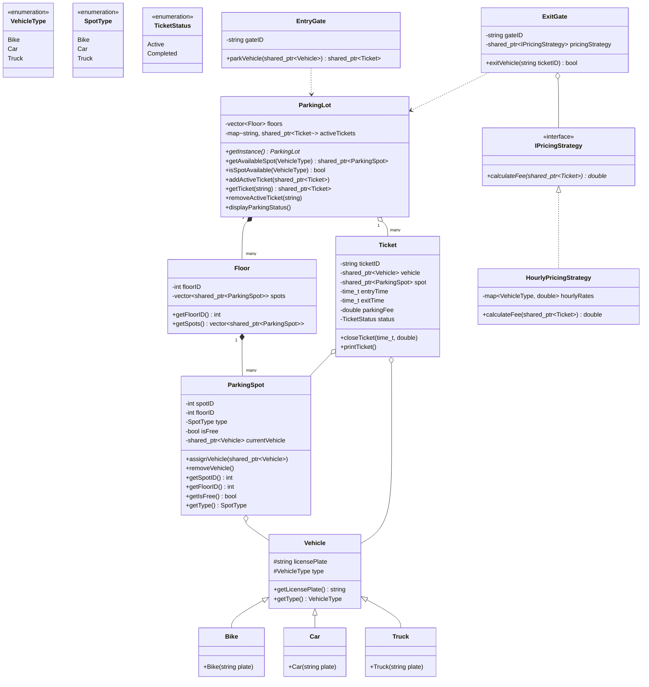

# Parking Lot System - Low Level Design (LLD)

## 📌 Problem Overview
Design a multi-floor Parking Lot management system capable of handling various types of vehicles (Bikes, Cars, Trucks) across multiple floors with automated entry and exit gate operations, dynamic pricing strategies, and real-time spot allocation.

---

## 🎯 Key Requirements

### 1. Functional Requirements
- **Multiple Vehicle Types**: Support for Bikes, Cars, and Trucks.
- **Multiple Floors & Spots**: The parking lot contains multiple floors, each with dedicated spots for each vehicle type.
- **Spot Allocation**: When a vehicle enters, find and assign the first available matching parking spot.
- **Ticket Generation**: Issue a unique parking ticket upon entry recording entry timestamp, spot details, and vehicle info.
- **Gate Management**: Multiple Entry and Exit gates operating simultaneously.
- **Dynamic Pricing (Strategy Pattern)**: Calculate parking fees upon vehicle exit based on parking duration and vehicle category.
- **Spot Deallocation**: Free up spots and complete tickets when vehicles exit.

### 2. Non-Functional Requirements
- **Clean Multi-Tier Architecture**: Strict separation of concerns (Models, Strategies, Services, Gates, Presentation).
- **Extensibility**: Easy addition of new vehicle types, spot types, or pricing strategies (Open/Closed Principle).
- **Concurrency & Thread Safety**: Singleton orchestrator implemented with thread-safe Meyers' Singleton.

---

## 🏗️ Architecture & Tier Breakdown

The system is organized into modular tiers:

```
Parking_Lot/
├── enums/
│   └── Enums.h                  # VehicleType, SpotType, TicketStatus
├── models/
│   ├── Vehicle.h / .cpp         # Base Vehicle & derived Bike, Car, Truck
│   ├── ParkingSpot.h / .cpp     # Spot entity tracking occupancy and vehicle
│   ├── Floor.h / .cpp           # Floor entity managing list of spots
│   └── Ticket.h / .cpp          # Parking ticket with status & timestamps
├── strategies/
│   ├── IPricingStrategy.h       # Strategy interface for fee calculation
│   └── HourlyPricingStrategy.h / .cpp # Concrete hourly billing strategy
├── services/
│   └── ParkingLot.h / .cpp      # Core Singleton orchestrator
├── gates/
│   ├── EntryGate.h / .cpp       # Handles vehicle arrivals & ticket issuance
│   └── ExitGate.h / .cpp        # Handles vehicle departures & fee settlement
├── main.cpp                     # Simulation driver program
├── Makefile                     # Build automation with make
├── CMakeLists.txt               # Cross-platform CMake configuration
└── README.md                    # LLD documentation
```

---

## 🧩 Design Patterns Used

| Pattern | Component | Rationale |
| :--- | :--- | :--- |
| **Singleton Pattern** | `ParkingLot` | Ensures a single centralized state coordinator for spots, floors, and active tickets across gates. Uses thread-safe Meyers' Singleton. |
| **Strategy Pattern** | `IPricingStrategy` / `HourlyPricingStrategy` | Decouples pricing calculation algorithms from exit gate operations, allowing runtime algorithm switching (e.g., flat, hourly, surge pricing). |
| **Inheritance & Polymorphism** | `Vehicle` -> `Bike`, `Car`, `Truck` | Provides clean entity hierarchy and type safety for different vehicles. |
| **Separation of Concerns** | `EntryGate`, `ExitGate`, `ParkingLot` | Gates act as controllers that interact with the service layer rather than directly mutating spots. |

---

## 📊 Class Diagram (Mermaid)



---

## ⚙️ How to Build and Run

### Option 1: Direct Compilation via `g++` (C++14/17)
```bash
g++ -std=c++14 -Wall -Wextra -I. \
    main.cpp \
    models/Vehicle.cpp \
    models/ParkingSpot.cpp \
    models/Floor.cpp \
    models/Ticket.cpp \
    strategies/HourlyPricingStrategy.cpp \
    services/ParkingLot.cpp \
    gates/EntryGate.cpp \
    gates/ExitGate.cpp \
    -o parking_lot

# Run executable:
# On Linux/macOS:
./parking_lot
# On Windows:
./parking_lot.exe
```

### Option 2: Using Makefile
```bash
make
make run
```

### Option 3: Using CMake
```bash
mkdir build && cd build
cmake ..
cmake --build .
./parking_lot
```

---

## 🖥️ Sample Output
```text
--- Starting CRED Parking Lot Simulation ---

--- Current Parking Lot Status ---
Floor 1: 6/6 spots available.
Floor 2: 6/6 spots available.
----------------------------------

[Gate ENT_1] Vehicle JH-01-AB-1234 arriving...
  -> Success! Assigned Floor 1, Spot 3.
------ TICKET [TKT-ENT_1-1-3] ------
Vehicle: JH-01-AB-1234
Spot: 3 (Floor: 1)
Status: ACTIVE
---------------------------------

[Gate ENT_2] Vehicle WB-02-XY-9876 arriving...
  -> Success! Assigned Floor 1, Spot 4.
------ TICKET [TKT-ENT_2-1-4] ------
Vehicle: WB-02-XY-9876
Spot: 4 (Floor: 1)
Status: ACTIVE
---------------------------------

[Gate ENT_1] Vehicle MH-12-TRK-99 arriving...
  -> Success! Assigned Floor 1, Spot 6.
------ TICKET [TKT-ENT_1-1-6] ------
Vehicle: MH-12-TRK-99
Spot: 6 (Floor: 1)
Status: ACTIVE
---------------------------------

[Gate ENT_2] Vehicle KA-05-BK-1111 arriving...
  -> Success! Assigned Floor 1, Spot 1.
------ TICKET [TKT-ENT_2-1-1] ------
Vehicle: KA-05-BK-1111
Spot: 1 (Floor: 1)
Status: ACTIVE
---------------------------------

--- Current Parking Lot Status ---
Floor 1: 2/6 spots available.
Floor 2: 6/6 spots available.
----------------------------------

[Exit Gate EXT_1] Processing Ticket: TKT-ENT_1-1-3...
  -> Total Fee: Rs. 40
  -> Success! Vehicle JH-01-AB-1234 exited. Floor 1, Spot 3 is now free.

[Gate ENT_1] Vehicle DL-10-ZZ-0000 arriving...
  -> Success! Assigned Floor 1, Spot 3.
------ TICKET [TKT-ENT_1-1-3] ------
Vehicle: DL-10-ZZ-0000
Spot: 3 (Floor: 1)
Status: ACTIVE
---------------------------------

--- Current Parking Lot Status ---
Floor 1: 2/6 spots available.
Floor 2: 6/6 spots available.
----------------------------------

--- Simulation Complete ---
```
